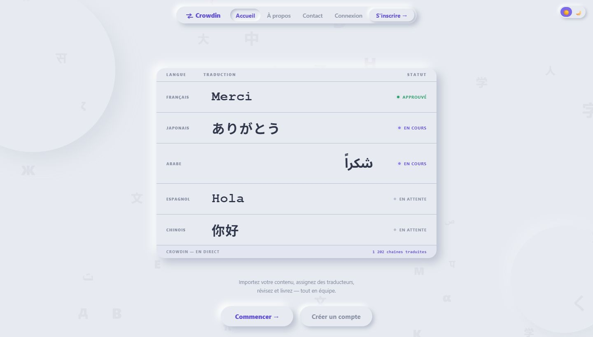
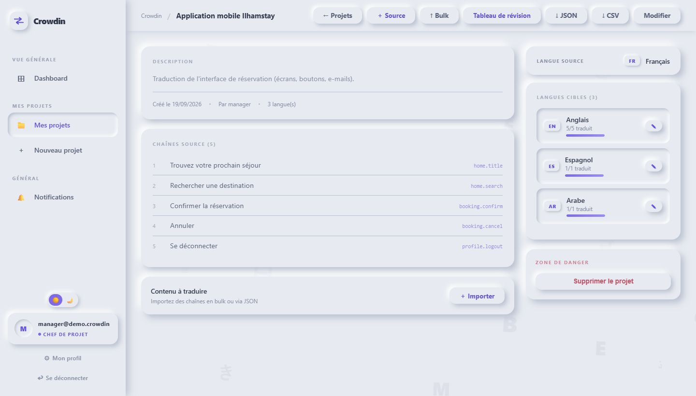
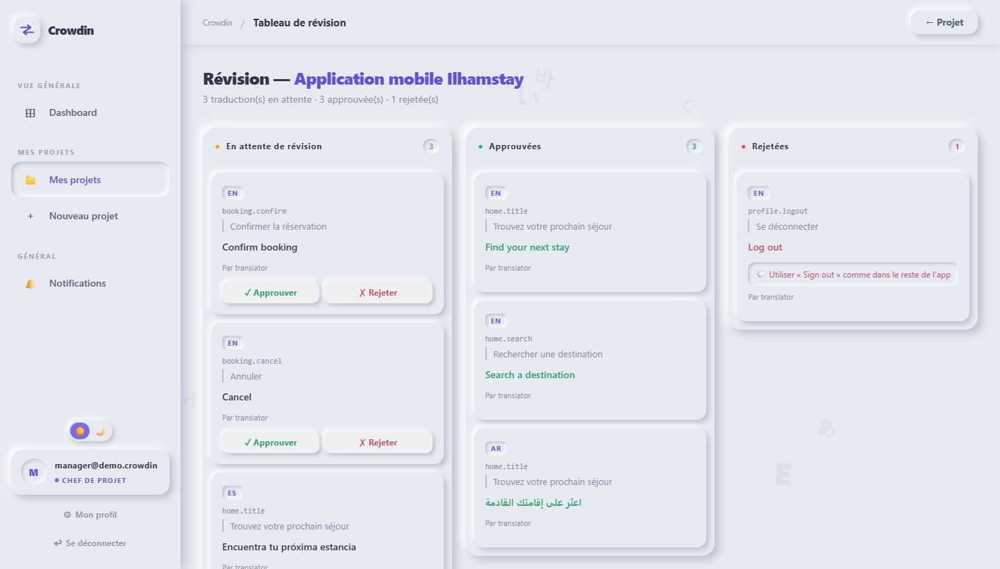

# Crowdin - plateforme de traduction collaborative

Application web qui met en relation des **chefs de projet** qui veulent faire traduire leur contenu et des **traducteurs indépendants**.
Projet d'équipe réalisé à l'ETNA (module TIC-WEB3, 2026).



| Espace projet | Tableau de révision |
|---|---|
|  |  |

---

## Fonctionnalités

- **Inscription / connexion** avec choix du rôle : chef de projet, traducteur, ou les deux
- **Profil** : nom, description, langues parlées et niveaux
- **Projets** : création, modification, suppression, export JSON / CSV
- **Chaînes source** : ajout une par une ou en masse (bulk / JSON)
- **Traduction** : interface dédiée par langue cible, avec suivi de l'avancement
- **Révision** : le chef de projet approuve ou rejette les traductions
- **Demandes d'accès** : un traducteur demande à rejoindre un projet
- **Notifications** ciblées pour chaque action
- **Espace admin** : demandes d'accès et signalements
- **Mode clair / sombre** et interface responsive

## Stack

- **PHP 8.2**, **Symfony 7.2**, Doctrine ORM, Twig
- **MySQL 8** (Docker)
- **PHPUnit** (tests de l'authentification, de la sécurité des mots de passe et de la validation)
- **Docker / Docker Compose**, Mailpit pour les emails de développement

## Mon rôle dans l'équipe

Nous étions trois. J'ai principalement travaillé sur :

- le **modèle de données** : les 7 entités, leurs repositories et les migrations Doctrine ;
- le **système d'authentification** (inscription, connexion, déconnexion, rôles) avec ses **tests PHPUnit** et sa documentation ;
- le **workflow de traduction**, avec des espaces séparés pour l'admin et le traducteur ;
- les **notifications** et les pages d'administration ;
- le **design de l'interface** (layout responsive, mode clair / sombre) ;
- la configuration **Docker** et la sortie des identifiants du code (variables d'environnement) ;
- l'intégration du travail de l'équipe avec Git (branches, merges).

## Lancer le projet

Prérequis : PHP 8.2+, Composer, Docker.

```bash
git clone https://github.com/codeWithIlham/crowdin-symfony.git
cd crowdin-symfony

composer install
cp .env.example .env          # puis adapter les valeurs

docker compose up -d          # MySQL + Mailpit
php bin/console doctrine:database:create --if-not-exists
php bin/console doctrine:migrations:migrate

symfony server:start          # ou : php -S localhost:8000 -t public/
```

Des comptes de démonstration (admin, chef de projet, traducteur, les deux) sont proposés directement sur la page de connexion. Ce sont des données fictives.

### Tests

```bash
php bin/phpunit
```

## Documentation

- [Base de données](DB/DOCUMENTATION.MD) (schéma dans [DB/schema.sql](DB/schema.sql))

## Équipe

- **Ilham AMIRAT**
- Dan Jorrys ASSONET : pages publiques (à propos, contact) et formulaire de contact
- Paulin Loïc LUHATA : partie base de données et tests associés
